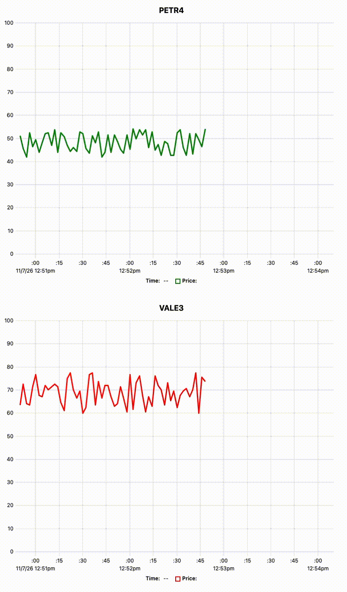

# SSE: live stock prices

A small proof of concept of **Server-Sent Events (SSE)** with Go and Redis pub/sub. The server streams simulated stock prices to the browser, which plots them in real time.



## How it works

1. When the page connects to `GET /stream/{symbol}`, the Go server subscribes to a Redis channel for that symbol (`petr4`, `vale3`) and starts publishing a simulated price to it every 2 seconds.
2. Each message received from Redis is sent to the browser as an SSE event.
3. The page listens with `EventSource` and plots the prices with [uPlot](https://github.com/leeoniya/uPlot), keeping a sliding window of the latest points.

**Stack:** Go (`net/http`, `go-redis`), Redis, uPlot.

## Running

From this folder:

```bash
docker compose up -d
go run .
```

Then open http://localhost:8080.
